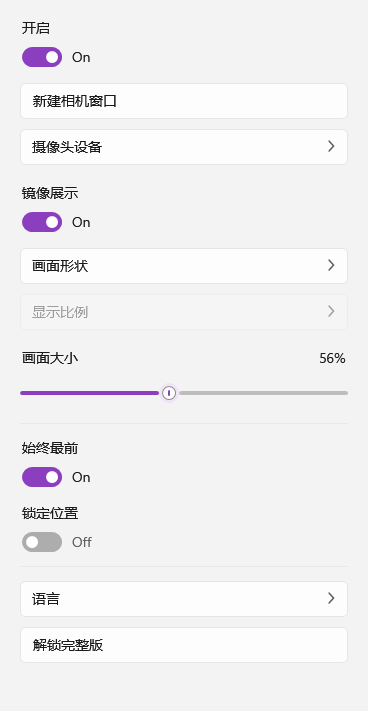
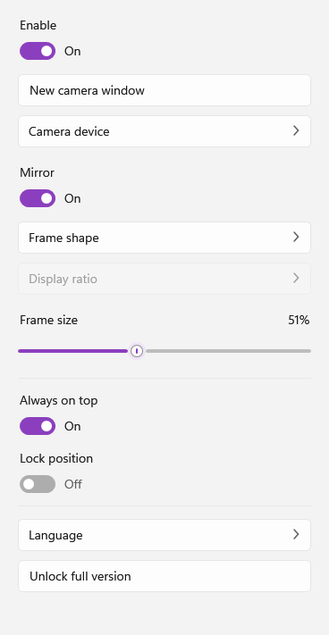

# FloatingCamera 悬浮摄像头

一款基于 Windows 11 原生组件（WPF / .NET 8）的桌面悬浮摄像头小工具。窗口是真正的逐像素透明悬浮层，可自由拖动、缩放，支持多种裁剪形状与显示比例，界面采用 Win11 Fluent 风格。

## 简介

悬浮摄像头（FloatingCamera）把电脑摄像头变成一个始终浮在桌面最上层的透明小窗口。它常驻在屏幕一角，不遮挡工作内容，让你在直播、录屏、开会或在线教学时随时看到自己的画面。

软件完全使用 Windows 11 原生组件开发（WPF / .NET 8），因此窗口是真正的逐像素透明悬浮层，而不是整块矩形抠图——圆形、圆角方形、方形等形状边缘干净平滑，没有黑边或白底。

主要特点：

- **开箱即用**：单文件绿色版，无需安装 .NET 运行时，双击即可运行
- **形态自由**：圆形 / 圆角方形 / 方形三种裁剪，配合自动、1:1、4:3、16:9 四种显示比例
- **尺寸可调**：20%–100% 缩放，面板滑块或鼠标滚轮都能调整
- **多窗口**：可同时创建多个悬浮摄像头，各自独立配置设备、形状与大小
- **轻量常驻**：系统托盘管理，支持锁定位置、始终最前、从 Alt+Tab 隐藏
- **中英双语**：界面文案可实时切换简体中文 / English

## 下载

- 蓝奏云：<https://cmaz.lanzoul.com/ifbie4bzggtc>
- 或直接使用仓库内的自包含单文件版本：[`dist/FloatingCamera.exe`](dist/FloatingCamera.exe)

## 截图

设置面板（简体中文 / English）：

| 简体中文 | English |
| --- | --- |
|  |  |

## 功能特性

- **悬浮透明窗口**：`AllowsTransparency` + 逐像素透明，非整块矩形抠图；从 Alt+Tab 列表中隐藏，保持纯悬浮窗语义
- **画面形状**：圆形 / 圆角方形 / 方形，按几何裁剪（`EllipseGeometry` / `RectangleGeometry`）
- **显示比例**：自动 / 1:1 / 4:3 / 16:9；选择圆形时该项自动禁用
- **画面大小**：20%–100%，支持设置面板滑块与鼠标滚轮缩放
- **镜像展示**：一键水平镜像
- **始终最前 / 锁定位置**：锁定后禁止拖动与滚轮缩放
- **多窗口**：可创建多个独立的摄像头悬浮窗，各自独立配置
- **中英文切换**：界面文案与下拉框选项实时刷新
- **系统托盘**：显示设置面板 / 新建相机窗口 / 隐藏全部窗口 / 退出
- **设备热插拔**：通过 WMI 监听摄像头插拔并自动刷新设备列表
- **单实例运行**：互斥量保证只运行一个进程

## 系统要求

- Windows 11（Windows 10 亦可运行）
- 无需安装 .NET 运行时——仓库内 `dist/FloatingCamera.exe` 为**自包含单文件**版本，双击即用

## 直接运行

下载或克隆后，双击运行：

```
dist/FloatingCamera.exe
```

首次启动会在桌面右下角出现一个圆形悬浮摄像头窗口，同时打开设置面板。

## 从源码构建

需要 [.NET 8 SDK](https://dotnet.microsoft.com/download/dotnet/8.0)：

```powershell
# 调试构建
dotnet build FloatingCamera/FloatingCamera.csproj -c Release

# 发布自包含单文件 exe
dotnet publish FloatingCamera/FloatingCamera.csproj -c Release -r win-x64 `
  --self-contained true -p:PublishSingleFile=true `
  -p:IncludeNativeLibrariesForSelfExtract=true `
  -p:EnableCompressionInSingleFile=true `
  -o dist
```

## 使用说明

| 操作 | 效果 |
| --- | --- |
| 拖动窗口 | 移动悬浮窗位置（锁定位置后失效） |
| 鼠标滚轮 | 调整画面大小（锁定位置后失效） |
| 鼠标悬停 | 显示设置 / 关闭按钮 |
| 双击画面 | 打开设置面板 |
| 双击托盘图标 | 打开设置面板 |
| 右键托盘图标 | 显示设置 / 新建窗口 / 隐藏全部 / 退出 |

设置项说明：

- **开启**：关闭后停止采集，窗口显示占位文字
- **摄像头设备**：在多个摄像头之间切换
- **画面形状 / 显示比例**：决定窗口裁剪区与长宽比
- **画面大小**：窗口尺寸，20%–100%
- **始终最前**：窗口是否保持在所有窗口之上
- **锁定位置**：防止误拖动、误缩放
- **语言**：简体中文 / English，切换后界面文案即时刷新

## 项目结构

```
FloatingCamera/
├─ App.xaml(.cs)            应用入口：单实例、托盘、多窗口与设备热插拔
├─ CameraWindow.xaml(.cs)   悬浮摄像头窗口：透明、裁剪、镜像、拖动、缩放
├─ SettingsWindow.xaml(.cs) Win11 风格设置面板
├─ CameraService.cs         摄像头采集（OpenCvSharp4 + DirectShow）
├─ CameraSettings.cs        单个悬浮窗的配置模型
├─ Localization.cs          轻量本地化（中 / 英）
├─ Converters.cs            绑定转换器
├─ Styles/Fluent.xaml       Win11 Fluent 控件样式（开关 / 下拉框 / 滑块 / 按钮）
├─ Assets/app.ico           应用图标
└─ tools/make_icon.py       图标生成脚本
docs/                       文档配图
dist/                       发布产物（自包含单文件 exe）
```

## 技术栈

- **WPF / .NET 8** — 原生桌面框架，实现透明悬浮窗口与 Fluent 风格自绘控件
- **OpenCvSharp4 4.10** — 摄像头采集与帧解码
- **System.Management** — WMI 设备热插拔监听
- **Windows Forms NotifyIcon** — 系统托盘图标与右键菜单

## 许可

本项目仅供学习与个人使用。
